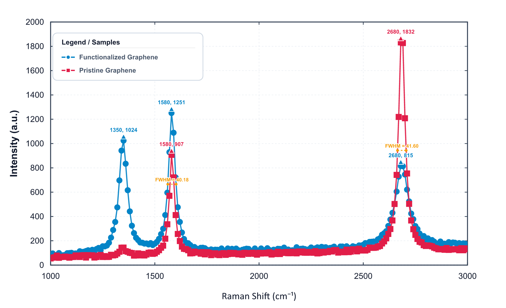

# 🎓 Academic Scatter Plot Generator / رسم‌کننده نمودار آکادمیک

[🇮🇷 برای مطالعه راهنما و توضیحات فارسی کلیک کنید](#-توضیحات-و-راهنمای-فارسی)

<p align="center">
  <b>A modern, zero-install, publication-ready scatter plot suite for academic researchers and students.</b><br>
  Create ISI/Nature-grade scientific figures with Excel/CSV imports, hysteresis loops, Cyclic Voltammetry (CV) analytics, LaTeX export, error bars, regression trendlines, and magnifier insets — entirely in your browser.
</p>

<p align="center">
  <a href="https://hasanmfar.github.io/Academic-Scatter-Plot/"></a>
  
  
  
  
</p>

<p align="center">
  
</p>

---

## ✨ Why this tool?

Researchers often struggle with complex, proprietary software (like OriginLab or MATLAB) just to plot experimental data or inspect sensor responses. 

**Academic Scatter Plot Generator** provides an intuitive, high-performance web studio that runs **100% locally in your browser**. No installation, no Python/R code, and zero server uploads — your scientific data never leaves your computer.

---

## 🚀 Key Features

### 🗂️ Categorized 5-Tab Workflow & Instant Search
- **No endless scrolling:** All controls are organized into 5 focused tabs:
  - 📊 **Data:** Fast sample picker, template generator, 50-row paginated table editor, noise filters (`Moving Average 3/5/9-pt`, `Spline`), and Y-transforms.
  - 📐 **Axes:** Bounds ($X/Y$ Min, Max, Step), Auto-Scale, logarithmic scales ($\log X$, $\log Y$), and tick formatting.
  - 🎨 **Style:** Publication presets, boxed vs. open frame, marker size, line width, series palette, and grid styling.
  - 🏷️ **Labels:** Titles, subtitles, $R^2$ trendlines, callout drag-and-drop, and legends.
  - ⚙️ **Tools:** Magnifier inset, canvas aspect presets (16:9, square, double-column), and figure margins.
- **🔍 Instant Search Engine:** Type any keyword (e.g. `font`, `grid`, `origin`, `log`, `خطا`, `لگاریتم`) to instantly highlight controls across all tabs and auto-navigate to the right section.
- **📌 Sticky Viewport:** The live plot stays locked in view on desktop screens so you get instant visual feedback for every tweak.

### 📐 Guaranteed Perimeter Spine Alignment (Clean Axis Numbers)
- **Publication Spine Standard:** Major/minor tick marks and numeric labels are strictly anchored to the outer boundary spines (`plotArea.x` and `plotArea.y + height`), preventing any overlap with experimental curves, markers, or text callouts.
- **Internal Crosshairs:** When using *Through Zero* or *Through Center*, clean dashed reference lines are drawn within the plot area without displacing the outer spine values.
- **Reverse Axes (Flip X / Flip Y):** Invert horizontal or vertical orientations with dynamic trendline and callout adaptation.

### ⚡ Multi-Domain Scientific Analytics Engine (CV, Spectroscopy, Hysteresis, General Stats)
- **Domain Selector Dropdown:** Seamlessly switch analytics between disciplines or let the app auto-detect:
  - **⚡ Cyclic Voltammetry (CV):** Anodic & cathodic peak potentials ($E_{pa}, E_{pc}$), peak separation ($\Delta E_p$), half-wave potential ($E_{1/2}$), peak current ratio ($|I_{pa}/I_{pc}|$), and cyclic loop charge/area ($\oint I \, dV$).
  - **🔬 Spectroscopy & Peaks:** Dominant peak wavelength/shift ($X_{peak}$), maximum intensity ($Y_{max}$), Full Width at Half Maximum (FWHM), integrated band area ($\int Y \, dX$), baseline offset, and Signal-to-Noise Ratio (SNR).
  - **🔄 Sensor Hysteresis & Loops:** Maximum hysteresis gap ($\Delta H_{max}$), sensor sensitivity ($S = \Delta Y / \Delta X$), full dynamic range, hysteresis loop area, recovery drift, and excitation peak.
  - **📊 General Statistics & Regression:** Mean, standard deviation ($\sigma$), range ($\Delta Y$), area under curve (AUC), linear regression slope ($m$), and determination coefficient ($R^2$).
- **One-Click Stats Copy:** Copy formatted metrics directly to the clipboard for reports and journal articles.
- **Publication In-Plot Legend:** Refined bi-directional legend with solid background, zero marker-text collisions, and responsive auto-sizing.

### 📋 LaTeX Table Generator (`\begin{tabular}...`)
- One-click button in the header toolbar formats active experimental series into standard LaTeX table code, ready to paste directly into Overleaf or journal manuscripts.

### 🏎️ High-Performance Engine (8,000+ Data Points in <3ms)
- Preamble-stripping parser handles raw instrument dumps with text headers and metadata blocks automatically.
- Paginated table viewer and delegated SVG event listeners maintain 60 FPS responsiveness even with dense instrument scans.

### 🔄 Smart Cyclic Hysteresis & Arrow Navigation
- Automatically detects forward and backward trajectories in cyclic experimental measurements (such as QCM humidity sensors, magnetic hysteresis, or stress-strain loops).
- Return paths are automatically rendered with distinct dashes and flow direction arrows.

### 🔬 Non-Linear Curve Fitting & Dynamic Equations
- **Multiple Mathematical Models:** Move beyond simple lines with built-in mathematical fits:
  - **Linear:** $y = mx + c$
  - **Polynomial (2nd Degree):** $y = ax^2 + bx + c$ via Cramer's rule / 3×3 normal equations
  - **Exponential:** $y = a \cdot e^{bx}$
  - **Power Law:** $y = a \cdot x^b$
- **High-Resolution Smooth Rendering:** Computes 80 SVG interpolated coordinates across active bounds for glass-smooth curves.
- **Goodness-of-Fit Metric:** Real-time determination coefficient ($R^2$) calculation and toggleable on-plot dynamic equation badges.

### 🏔️ Automated Peak Finder & Full Width at Half Maximum (FWHM)
- **Local Extrema Detection:** Automatically identifies experimental peaks and valleys with adjustable sensitivity (3 to 15 points) and prominence thresholding.
- **FWHM Spectral Bandwidth:** Computes the Full Width at Half Maximum for dominant peaks, vital for spectroscopy, XRD, and chromatography.
- **Peak Coordinate Labels & Tabular Summary:** Labels peak locations $(X, Y)$ directly on curves and generates a tabular summary in the Tools tab with one-click clipboard copying.

### 🎨 Curated Scientific Color Palettes
- **Publication-Ready Schemes:** Switch your entire figure's color harmony in one click:
  - **Modern Vibrant:** Sleek high-energy cyan, rose, emerald, and amber.
  - **Editorial Classic:** Timeless deep navy, crimson, forest green, and slate.
  - **Clinical & Biomedical:** Soft, authoritative blues, teal, mauve, and coral.
  - **High-Contrast Engineering:** Maximum legibility cobalt, orange, violet, and gold.
  - **Viridis Scientific:** Perceptually uniform colormap ideal for physical sciences.
  - **Colorblind-Safe Wong:** Mathematically optimized for readers with color vision deficiencies.

### 🎯 Live Crosshair Coordinate Inspector
- Interactive SVG crosshair badge follows your cursor across the plotting canvas with microsecond latency, displaying instantaneous $(X, Y)$ values for point-by-point inspection without altering the underlying data.

### 📥 Clean Processed Data Export (Excel & CSV)
- Export the active dataset with all noise filtering (moving average, spline), normalization, and sorting applied as a clean, standardized `.xlsx` or `.csv` spreadsheet ready for secondary processing or archival.

### 📈 Statistical Regression & Error Bars
- **Trendline & $R^2$:** One-click best-fit regression lines with slope, intercept, and determination coefficient ($R^2$) calculation.
- **Standard Deviation Error Bars:** Automatically attaches `_SD` or `_err` columns as symmetric $\pm\text{SD}$ error bars.

### 🔍 Magnifier Inset (Zoom Region)
- Frame crowded or complex regions (such as spectrum crossovers or diode knees) and showcase them in a high-resolution inset directly inside the plot.
- Interactive drag-to-select directly on the chart, with customizable corner positioning.

### 📁 Drag-and-Drop Visual Overlay & Keyboard Shortcuts
- Full-window drop-zone overlay with support for `.xlsx`, `.xls`, `.csv`, `.tsv`, `.txt`, `.dat`, and `.prn` files.
- Academic keyboard shortcuts:
  - `Ctrl + S`: Instant 600 DPI PNG figure export.
  - `Ctrl + C`: Copy chart image to system clipboard.
  - `Ctrl + F`: Quick jump to settings search.

### 🖼️ Publication-Quality Export
- **Ultra-HD Raster:** Export at **300 DPI** or **600 DPI PNG** ready for LaTeX, MS Word, and PowerPoint.
- **Vector Graphics:** Export native vector **SVG** for lossless editing in Adobe Illustrator or Inkscape.
- **One-Click Clipboard:** Direct copy-paste into documents.

---

## 🖼️ Gallery

Every figure below was rendered entirely by the app's SVG engine. The original data files are available in [`samples/`](samples).

<table>
<tr>
<td align="center"><br><sub><b>QCM Humidity Hysteresis</b><br>Boxed frame, cyclic direction arrows</sub></td>
<td align="center"><br><sub><b>Beer–Lambert Calibration</b><br>±SD error bars, linear fit & R²</sub></td>
</tr>
<tr>
<td align="center"><br><sub><b>UV-Vis Absorption Spectra</b><br>Multi-sample curves with open frame</sub></td>
<td align="center"><br><sub><b>Damped Oscillation (121 pts)</b><br>Axes through zero, spline smoothing</sub></td>
</tr>
<tr>
<td align="center"><br><sub><b>Impedance Bode Plot</b><br>5-decade log scale, dark theme</sub></td>
<td align="center"><br><sub><b>Solar Cell I–V Characteristic</b><br>Knee point fill-factor inspection</sub></td>
</tr>
<tr>
<td align="center"><br><sub><b>Magnifier Inset</b><br>Secondary zoomed detail window</sub></td>
<td align="center"><br><sub><b>Persian / RTL Mode</b><br>Full academic typography & bilingual support</sub></td>
</tr>
<tr>
<td align="center" colspan="2"><br><sub><b>Raman Spectroscopy & Peak Finder</b><br>D, G, and 2D characteristic bands with automated peak detection</sub></td>
</tr>
</table>

### 📂 Included Sample Datasets

| File | Application & What It Demonstrates |
|------|------------------------------------|
| [`samples/Raman_Spectroscopy.xlsx`](samples/Raman_Spectroscopy.xlsx) | Raman Spectroscopy — 201 points, D/G/2D graphene bands, automated peak finder & FWHM |
| [`samples/Cyclic_Voltammetry.xlsx`](samples/Cyclic_Voltammetry.xlsx) | Cyclic Voltammetry (CV) — 7,996 points, automated redox peaks ($E_{pa}, E_{pc}, \Delta E_p$), and loop area |
| [`samples/QCM_Hysteresis.xlsx`](samples/QCM_Hysteresis.xlsx) | Cyclic sensor response — hysteresis loop detection and dashed return lines |
| [`samples/BeerLambert_Calibration.xlsx`](samples/BeerLambert_Calibration.xlsx) | Linear regression — trendline equation, $R^2$, and automated error bars |
| [`samples/Damped_Oscillation.xlsx`](samples/Damped_Oscillation.xlsx) | Dense dynamic series — 121 points, spline interpolation, and sorting |
| [`samples/UVVis_Spectra.xlsx`](samples/UVVis_Spectra.xlsx) | Multiple spectra comparison — automated color and marker assignment |
| [`samples/Impedance_Bode.xlsx`](samples/Impedance_Bode.xlsx) | Wide frequency range — logarithmic horizontal axis ($\log_{10} X$) |
| [`samples/Solar_Cell_IV.xlsx`](samples/Solar_Cell_IV.xlsx) | Photovoltaic performance — direct callouts and custom axis intervals |

---

## 🛠️ How to Use

1. **Launch:** Open the **[Online App](https://hasanmfar.github.io/Academic-Scatter-Plot/)** or download this repository and double-click `index.html`.
2. **Load Data:** Choose a bundled dataset from the dropdown, or click **Download Excel Template**, populate your experimental values, and upload your `.xlsx` or `.csv`.
3. **Customize:** Switch between the **Data**, **Axes**, **Style**, **Labels**, and **Tools** tabs to fine-tune your visualization.
4. **Export:** Click **Export PNG (600 DPI)**, **SVG**, or **Copy LaTeX** and embed directly into your manuscript.

---

## 🧰 Architecture & Tech Stack

- **Zero Dependencies at Runtime:** Built entirely with standard modern HTML5, CSS3, and Vanilla JavaScript.
- **Client-Side Security:** File parsing is handled via an offline bundle of [SheetJS](https://sheetjs.com/). No telemetry, no external API calls.
- **Vector-First Rendering:** Dynamic SVG ensures crisp presentation at any zoom level or print scale.
- **Automated Testing Suite:** 
  ```bash
  npm test
  ```
  Runs full headless test suites in JSDOM covering DOM rendering, sample loaders, CSV/TSV parsers, and Excel integrity.

---

<br>

# 🇮🇷 توضیحات و راهنمای فارسی

یک استودیوی تحت وب زیبا، تعاملی، پیشرفته و کاملاً مستقل برای دانشجویان، اساتید و پژوهشگران، جهت رسم **نمودارهای علمی و دانشگاهی در سطح مقالات ISI** بدون نیاز به حتی یک خط کدنویسی.

**▶️ [ورود به نسخه آنلاین (بدون نیاز به نصب)](https://hasanmfar.github.io/Academic-Scatter-Plot/)**

---

## ✨ چرا این برنامه؟
بسیاری از پژوهشگران برای رسم نمودارهای ساده یا تحلیل داده‌های آزمایشگاهی ناچار به استفاده از نرم‌افزارهای حجیم مانند OriginLab یا MATLAB می‌شوند. این ابزار با فراهم کردن رابط کاربری مدرن، تعاملی و مجهز به **تب‌بندی موضوعی، موتور تحلیل ولتامتری چرخه‌ای و خروجی LaTeX**، امکان ساخت نمودارهای دقیق علمی با کیفیت ۶۰۰ DPI را در کسری از ثانیه فراهم می‌سازد. تمامی پردازش‌ها ۱۰۰٪ درون مرورگر شما انجام شده و هیچ داده‌ای در سرور ذخیره نمی‌شود.

---

## 🚀 ویژگی‌های کلیدی

### 🗂️ پنل تنظیمات ۵ تبه و موتور جستجوی هوشمند
- **پایان اسکرول‌های طولانی:** کلیهٔ ابزارها در ۵ دسته مشخص مرتب شده‌اند:
  - 📊 **داده‌ها:** بارگذاری نمونه‌های آماده، تمپلیت اکسل، جدول داده صفحه‌بندی‌شده (۵۰ سطر)، فیلترهای نویز (میانگین متحرک ۳، ۵ و ۹ نقطه)، اتصال Spline، نرمال‌سازی و میله‌های خطا.
  - 📐 **محورها:** تعیین حدود Min/Max/Step، دکمه تنظیم خودکار (Auto Scale)، مقیاس لگاریتمی ($\log X, \log Y$)، محل تلاقی محورها و فرمت ارقام.
  - 🎨 **ظاهر:** پیش‌تنظیمات استاندارد مقالات، کادر بسته (Boxed) یا باز (Open)، اندازه مارکرها، ضخامت خطوط و خطوط راهنمای شبکه.
  - 🏷️ **عناوین:** متون نمودار و محورها، فرمول خط روند، ضریب $R^2$، کشیدن و رها کردن لیبل‌ها با ماوس و راهنمای نمونه‌ها.
  - ⚙️ **ابزارها:** ذره‌بین بزرگ‌نمایی (Magnifier Inset)، نسبت‌های استاندارد تصویر (۱۶:۹، مربعی، دو ستونی) و اندازه چاپی.
- **🔍 جستجوی سریع تنظیمات:** با تایپ هر واژه (مانند «فونت»، «رنگ»، «لگاریتم»، «خطا»، «تیک»)، کنترل مربوطه فوراً هایلایت شده و تب مربوطه باز می‌شود.
- **📌 پین شدن نمودار (Sticky Layout):** نمودار همیشه در جلوی دید کاربر ثابت می‌ماند و همزمان با اعمال تنظیمات تغییرات به صورت زنده نمایش داده می‌شود.

### 📐 چیدمان استاندارد و تمیز محورها (تضمین عدم تداخل با داده‌ها)
- **ارقام همیشه روی کادر بیرونی:** اعداد محور افقی و عمودی همواره در حاشیه بیرونی کادر نمودار قرار می‌گیرند و هرگز روی خطوط داده، مارکرها یا منحنی‌های آزمایشگاهی تداخل ایجاد نمی‌کنند.
- **خطوط کمکی مبدأ و مرکز:** در حالت «از صفر» یا «از وسط»، خطوط راهنمای ظریف خط‌چین در داخل نمودار رسم می‌شوند بدون آنکه اعداد محور از کادر بیرونی جابجا شوند.
- **برعکس کردن محورها (Flip X / Flip Y):** قرینه‌سازی جهت با حفظ موقعیت هوشمند راهنما و خط روند.

### ⚡ موتور آنالیز علمی چندرشته‌ای (Multi-Domain Scientific Analytics)
- **منوی انتخاب نوع تحلیل علمی:** امکان انتخاب دستی یا تشخیص خودکار حوزه تحلیلی بر اساس نوع داده‌ها:
  - **⚡ ولتامتری چرخه‌ای (CV):** محاسبه پتانسیل پیک آندی ($E_{pa}$)، پتانسیل پیک کاتدی ($E_{pc}$)، فاصله دو پیک ($\Delta E_p$)، پتانسیل نیمه‌موج ($E_{1/2}$)، نسبت جریان ($|I_{pa}/I_{pc}|$) و مساحت انتگرال بار حلقه ($\oint I \, dV$).
  - **🔬 طیف‌سنجی و پیک‌ها (Spectroscopy):** طول‌موج/عدد موج پیک شاخص ($X_{peak}$)، بیشینه شدت ($Y_{max}$)، عرض نیمه‌ارتفاع (FWHM)، انتگرال مساحت باند ($\int Y \, dX$)، خط پایه و نسبت سیگنال به نویز (SNR).
  - **🔄 سنسور و حلقه هیسترزیس (Hysteresis):** بیشینه شکاف هیسترزیس ($\Delta H_{max}$)، حساسیت سنسور ($S = \Delta Y / \Delta X$)، گستره دینامیکی پاسخ، مساحت حلقه، خطای بازگشت (Drift) و ماکزیمم تحریک.
  - **📊 آمار توصیفی و رگرسیون (General Statistics):** میانگین، انحراف معیار ($\sigma$)، دامنه تغییرات ($\Delta Y$)، سطح زیر منحنی (AUC)، شیب رگرسیون خطی ($m$) و ضریب تعیین ($R^2$).
- **دکمه کپی فوری مشخصات تحلیلی:** کپی جدول متریک‌های استخراج‌شده در کلیپ‌بورد با عنوان حوزه تخصصی.
- **راهنمای داخل نمودار (In-Plot Legend) بازطراحی‌شده:** چینش استاندارد و بدون تداخل مارکر و متن، پشتیبانی از متون فارسی و انگلیسی، پس‌زمینه سالید و ابعاد هوشمند.

### 📋 خروجی جدول LaTeX برای مقالات (Overleaf)
- دکمه اختصاصی در نوار ابزار بالا جهت تولید و کپی کد آماده جدول LaTeX (`\begin{table} \begin{tabular}`) از داده‌های فعال با فرمت استاندارد مقالات علمی.

### 🏎️ موتور پردازش پرسرعت داده‌های حجیم (بیش از ۸,۰۰۰ نقطه زیر ۳ میلی‌ثانیه)
- حذف خودکار سربرگ‌ها و متن‌های دستگاهی در فایل‌های خام آزمایشگاهی.
- جدول ۵۰ سطری صفحه‌بندی‌شده و Event Delegation در SVG جهت پیمایش کاملاً روان و بدون لگ.

### 🔄 تشخیص هوشمند حلقه هیسترزیس (رفت و برگشت)
- شناسایی خودکار مسیر رفت و بازگشت داده‌های چرخه‌ای سنسورها با ترسیم خط‌چین و پیکان‌های جهت‌نما.

### 🔬 برازش منحنی‌های غیرخطی و معادلات ریاضی زنده (Non-Linear Fitting)
- **مدل‌های متنوع ریاضی:** برازش داده‌های تجربی با مدل‌های استانداردی فراتر از خط مستقیم:
  - **خطی:** $y = mx + c$
  - **چندجمله‌ای درجه ۲ (Polynomial):** $y = ax^2 + bx + c$ با حل ماتریسی ۳×۳ و قاعده کرامر
  - **نمایی (Exponential):** $y = a \cdot e^{bx}$
  - **توانی (Power Law):** $y = a \cdot x^b$
- **رسم نرم و باکیفیت:** درونیابی ۸۰ نقطه SVG برای رسم منحنی‌های کاملاً پیوسته و بدون شکستگی.
- **ارزیابی دقت برازش:** محاسبه خودکار ضریب تعیین ($R^2$) و نمایش شناور فرمول برازش روی نمودار.

### 🏔️ آشکارساز هوشمند پیک‌ها و پهنا در نیمه‌ارتفاع (Peak Finder & FWHM)
- **شناسایی خودکار قله‌ها و دره‌ها:** تشخیص اتوماتیک اکسترمم‌های محلی با تنظیم حساسیت (۳ تا ۱۵ نقطه) و فیلتر برجستگی (Prominence).
- **محاسبه عرض در نیمه ارتفاع (FWHM):** تحلیل پهنای باند پیک شاخص برای کاربردهای طیف‌سنجی (مانند رامان، XRD، UV-Vis و کروماتوگرافی).
- **برچسب‌گذاری مختصات و جدول پیک‌ها:** درج مستقیم برچسب $(X, Y)$ روی قله‌ها و تهیه جدول در تب ابزارها با امکان کپی یک‌کلیکه در کلیپ‌بورد.

### 🎨 پالت‌های رنگی استاندارد نشریات علمی
- **تغییر یکپارچه هارمونی رنگ‌ها:** اعمال فوری رنگ‌های هماهنگ و چشم‌نواز با یک کلیک:
  - **مدرن پرانرژی (Modern Vibrant):** رنگ‌های جذاب فیروزه‌ای، رزی، زمردی و کهربایی.
  - **کلاسیک ژورنالی (Editorial Classic):** سرمه‌ای عمیق، یاقوتی، سبز جنگلی و فیلی.
  - **بالینی و زیست‌پزشکی (Clinical & Biomedical):** آبی ملو، فیروزه‌ای، یاسی و مرجانی.
  - **کنتراست بالای مهندسی (High-Contrast Engineering):** لاجوردی، نارنجی، بنفش و زرد پررنگ.
  - **طیف علمی Viridis:** مقیاس ادراکی یکنواخت برای داده‌های پیوسته فیزیک و شیمی.
  - **سازگار با کوررنگی (Colorblind-Safe Wong):** بهینه‌سازی‌شده بر پایه الگوریتم‌های استاندارد بینایی.

### 🎯 نشانگر متقاطع مختصات زنده (Live Crosshair Inspector)
- ردگیری آنی مکان‌نما با خطوط متقاطع SVG و نشانگر شناور مختصات دقیق $(X, Y)$ بر روی سطح نمودار بدون ایجاد تغییر در داده‌های اصلی.

### 📥 خروجی داده‌های پردازش‌شده تمیز (Clean Data Export)
- ذخیره و بارگیری فایل‌های اکسل (`.xlsx`) و متنی (`.csv`) تمیز و استاندارد از داده‌های نهایی پس از اعمال فیلترهای کاهش نویز، اتصال Spline، نرمال‌سازی و مرتب‌سازی جهت استفاده در سایر نرم‌افزارها یا بایگانی آزمایشگاهی.

### 📈 رگرسیون خطی و میله‌های خطا
- محاسبه شیب خط، عرض از مبدأ و ضریب تعیین $R^2$ و نمایش فرمول برازش.
- افزودن خودکار ستون‌های خطا به‌صورت میله‌های خطای متقارن $\pm\text{SD}$.

### 🔍 ذره‌بین بزرگ‌نمایی (Magnifier Inset)
- بزرگ‌نمایی بخش‌های شلوغ یا تقاطع‌های حساس با کادر Inset درون خود نمودار با قابلیت کشیدن مستطیل با ماوس.

### 📁 اورلی درگ اند دراپ و کلیدهای میانبر کیبورد
- لایه بصری رها کردن فایل داده در هر کجای پنجره با پشتیبانی از اکسل و فایل‌های متنی (`.xlsx`, `.csv`, `.tsv`, `.txt`).
- کلیدهای میانبر:
  - `Ctrl + S`: دانلود فوری تصویر با کیفیت ۶۰۰ DPI.
  - `Ctrl + C`: کپی نمودار در کلیپ‌بورد.
  - `Ctrl + F`: پرش سریع به کادر جستجوی تنظیمات.

### 🖼️ خروجی مناسب چاپ در ژورنال‌ها
- خروجی تصویر با وضوح فوق‌العاده **300 و 600 DPI (PNG)** برای Word و LaTeX.
- خروجی وکتور بی‌نهایت باکیفیت **SVG** برای Illustrator و Inkscape.
- دکمه کپی فوری نمودار در کلیپ‌بورد.

---

## 🛠️ راهنمای سریع استفاده

۱. **اجرا:** وارد **[نسخه آنلاین](https://hasanmfar.github.io/Academic-Scatter-Plot/)** شوید یا مخزن را دانلود کرده و فایل `index.html` را در مرورگر باز کنید.
۲. **ورود داده:** یکی از دیتاست‌های آماده را انتخاب کنید یا قالب خام اکسل را دانلود، پر کرده و مجدداً آپلود نمایید.
۳. **تنظیمات:** با استفاده از تب‌های سایدبار و نوار جستجو، ابعاد، فونت، رنگ‌ها و خطوط را سفارشی کنید.
۴. **خروجی:** با کلیک بر روی **PNG (600 DPI)** یا **SVG** یا **کپی LaTeX** فایل مقاله خود را دریافت کنید.

---
*توسعه‌داده‌شده برای جامعه دانشگاهی و علمی — متن‌باز و آزاد.*
