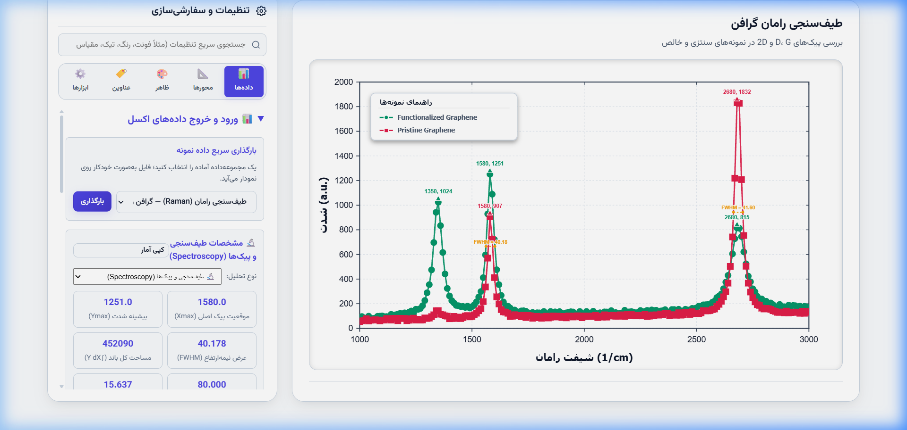
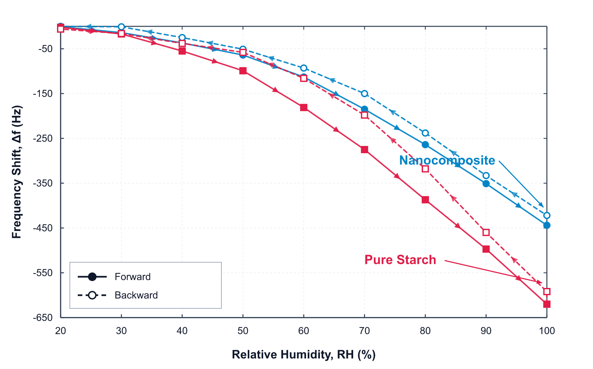
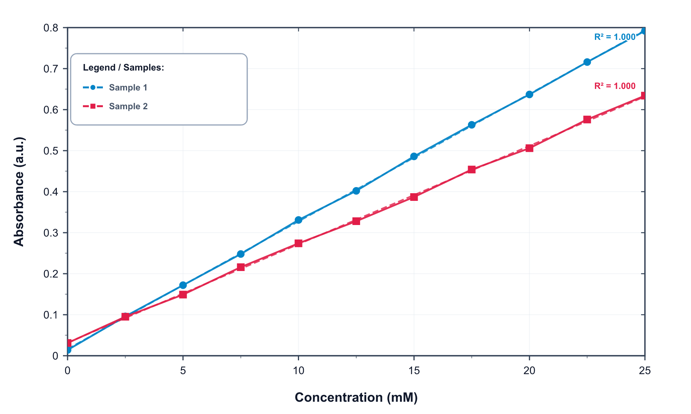
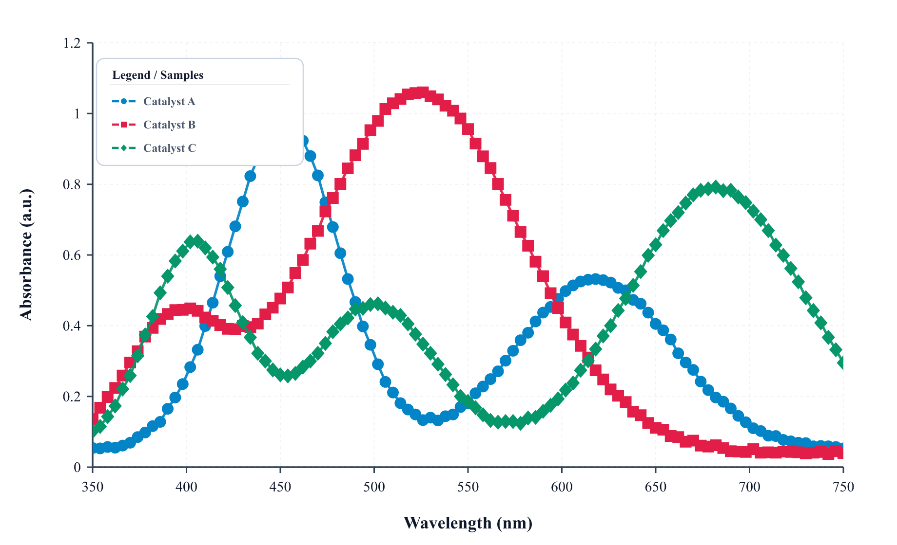
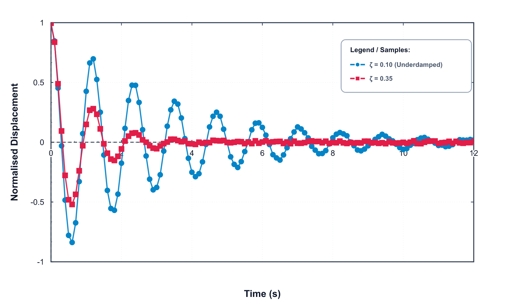
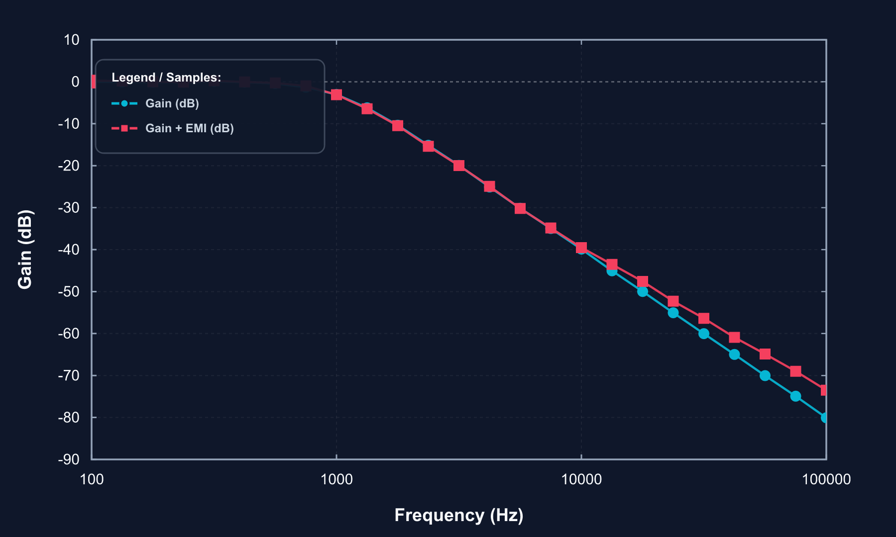
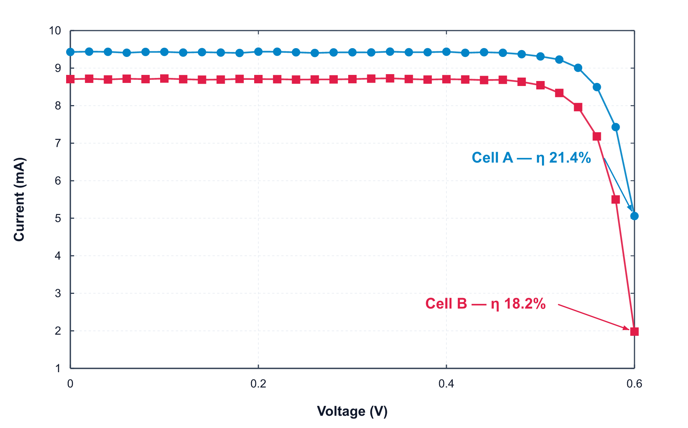
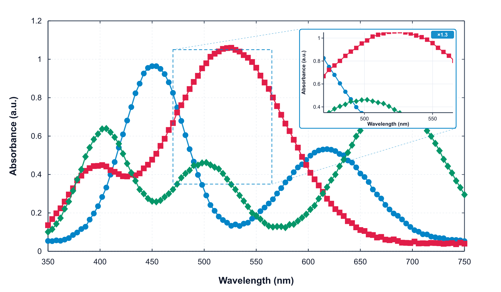
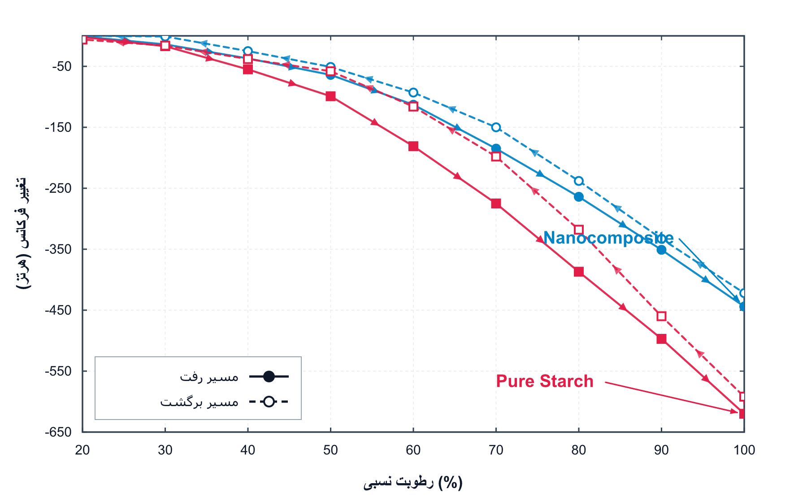

# 🎓 Academic Scatter Plot Generator / رسم‌کننده نمودار آکادمیک

[🇮🇷 برای مطالعه راهنما و توضیحات فارسی کلیک کنید](#-توضیحات-و-راهنمای-فارسی)

<p align="center">
  <b>A modern, zero-install, publication-ready scatter plot suite for academic researchers and students.</b><br>
  Create ISI/Nature-grade scientific figures with Excel/CSV imports, hysteresis loops, error bars, regression trendlines, and magnifier insets — entirely in your browser.
</p>

<p align="center">
  <a href="https://hasanmfar.github.io/Academic-Scatter-Plot/"></a>
  
  
  
  
</p>

<p align="center">
  
</p>

---

## ✨ Why this tool?

Researchers often struggle with complex, proprietary software (like OriginLab or MATLAB) just to plot experimental data or inspect sensor responses. 

**Academic Scatter Plot Generator** provides an intuitive, high-performance web studio that runs **100% locally in your browser**. No installation, no Python/R code, and zero server uploads — your scientific data never leaves your computer.

---

## 🚀 Key Features

### 🗂️ Categorized 5-Tab Workflow & Instant Search
- **No endless scrolling:** All controls are organized into 5 focused tabs:
  - 📊 **Data:** Fast sample picker, template generator, raw table editor, smoothing (Spline/Straight), and normalization.
  - 📐 **Axes:** Bounds ($X/Y$ Min, Max, Step), Auto-Scale, logarithmic scales ($\log X$, $\log Y$), and tick formatting.
  - 🎨 **Style:** Publication presets, boxed vs. open frame, marker size, line width, series palette, and grid styling.
  - 🏷️ **Labels:** Titles, subtitles, $R^2$ trendlines, callout drag-and-drop, and legends.
  - ⚙️ **Tools:** Magnifier inset, canvas aspect presets (16:9, square, double-column), and figure margins.
- **🔍 Instant Search Engine:** Type any keyword (e.g. `font`, `grid`, `origin`, `log`, `خطا`, `لگاریتم`) to instantly highlight controls across all tabs and auto-navigate to the right section.
- **📌 Sticky Viewport:** The live plot stays locked in view on desktop screens so you get instant visual feedback for every tweak.

### 📐 Precision Axis Origins & Mathematical Alignment
- **Classic Corner:** Traditional bottom-left quadrant layout.
- **Through Zero $(0, 0)$:** Axes intersect at the exact origin, with contrast halos around ticks.
- **Through Center:** Symmetrical balanced bounds across four quadrants for bipolar signals or cyclic measurements.
- **Reverse Axes (Flip X / Flip Y):** Invert horizontal or vertical orientations with dynamic trendline and callout adaptation.

### 🔄 Smart Cyclic Hysteresis & Arrow Navigation
- Automatically detects forward and backward trajectories in cyclic experimental measurements (such as QCM humidity sensors, magnetic hysteresis, or stress-strain loops).
- Return paths are automatically rendered with distinct dashes and flow direction arrows.

### 📈 Statistical Regression & Error Bars
- **Trendline & $R^2$:** One-click linear best-fit regression line with automatic slope, intercept, and determination coefficient ($R^2$) calculation.
- **Standard Deviation Error Bars:** Automatically attaches `_SD` or `_err` columns as symmetric $\pm\text{SD}$ error bars.

### 🔍 Magnifier Inset (Zoom Region)
- Frame crowded or complex regions (such as spectrum crossovers or diode knees) and showcase them in a high-resolution inset directly inside the plot.
- Interactive drag-to-select directly on the chart, with customizable corner positioning.

### 🧾 Universal Data Import
- **Excel:** Native drag-and-drop support for `.xlsx` and `.xls` files.
- **Plain-Text:** Full compatibility with `.csv`, `.tsv`, `.txt`, `.dat`, and `.prn` files.
- **Encoding & Delimiter Detection:** Automatic detection of commas, tabs, semicolons, whitespace, UTF-8, UTF-16, and Windows codepages.

### 🖼️ Publication-Quality Export
- **Ultra-HD Raster:** Export at **300 DPI** or **600 DPI PNG** ready for LaTeX, MS Word, and PowerPoint.
- **Vector Graphics:** Export native vector **SVG** for lossless editing in Adobe Illustrator or Inkscape.
- **One-Click Clipboard:** Direct copy-paste into documents.

---

## 🖼️ Gallery

Every figure below was rendered entirely by the app's SVG engine. The original data files are available in [`samples/`](samples).

<table>
<tr>
<td align="center"><br><sub><b>QCM Humidity Hysteresis</b><br>Boxed frame, cyclic direction arrows</sub></td>
<td align="center"><br><sub><b>Beer–Lambert Calibration</b><br>±SD error bars, linear fit & R²</sub></td>
</tr>
<tr>
<td align="center"><br><sub><b>UV-Vis Absorption Spectra</b><br>Multi-sample curves with open frame</sub></td>
<td align="center"><br><sub><b>Damped Oscillation (121 pts)</b><br>Axes through zero, spline smoothing</sub></td>
</tr>
<tr>
<td align="center"><br><sub><b>Impedance Bode Plot</b><br>5-decade log scale, dark theme</sub></td>
<td align="center"><br><sub><b>Solar Cell I–V Characteristic</b><br>Knee point fill-factor inspection</sub></td>
</tr>
<tr>
<td align="center"><br><sub><b>Magnifier Inset</b><br>Secondary zoomed detail window</sub></td>
<td align="center"><br><sub><b>Persian / RTL Mode</b><br>Full academic typography & bilingual support</sub></td>
</tr>
</table>

### 📂 Included Sample Datasets

| File | Application & What It Demonstrates |
|------|------------------------------------|
| [`samples/QCM_Hysteresis.xlsx`](samples/QCM_Hysteresis.xlsx) | Cyclic sensor response — hysteresis loop detection and dashed return lines |
| [`samples/BeerLambert_Calibration.xlsx`](samples/BeerLambert_Calibration.xlsx) | Linear regression — trendline equation, $R^2$, and automated error bars |
| [`samples/Damped_Oscillation.xlsx`](samples/Damped_Oscillation.xlsx) | Dense dynamic series — 121 points, spline interpolation, and sorting |
| [`samples/UVVis_Spectra.xlsx`](samples/UVVis_Spectra.xlsx) | Multiple spectra comparison — automated color and marker assignment |
| [`samples/Impedance_Bode.xlsx`](samples/Impedance_Bode.xlsx) | Wide frequency range — logarithmic horizontal axis ($\log_{10} X$) |
| [`samples/Solar_Cell_IV.xlsx`](samples/Solar_Cell_IV.xlsx) | Photovoltaic performance — direct callouts and custom axis intervals |

---

## 🛠️ How to Use

1. **Launch:** Open the **[Online App](https://hasanmfar.github.io/Academic-Scatter-Plot/)** or download this repository and double-click `index.html`.
2. **Load Data:** Choose a bundled dataset from the dropdown, or click **Download Excel Template**, populate your experimental values, and upload your `.xlsx` or `.csv`.
3. **Customize:** Switch between the **Data**, **Axes**, **Style**, **Labels**, and **Tools** tabs to fine-tune your visualization.
4. **Export:** Click **Export PNG (600 DPI)** or **SVG** and embed directly into your manuscript.

---

## 🧰 Architecture & Tech Stack

- **Zero Dependencies at Runtime:** Built entirely with standard modern HTML5, CSS3, and Vanilla JavaScript.
- **Client-Side Security:** File parsing is handled via an offline bundle of [SheetJS](https://sheetjs.com/). No telemetry, no external API calls.
- **Vector-First Rendering:** Dynamic SVG ensures crisp presentation at any zoom level or print scale.
- **Automated Testing Suite:** 
  ```bash
  npm test
  ```
  Runs full headless test suites in JSDOM covering DOM rendering, sample loaders, CSV/TSV parsers, and Excel integrity.

---

<br>

# 🇮🇷 توضیحات و راهنمای فارسی

یک استودیوی تحت وب زیبا، تعاملی، پیشرفته و کاملاً مستقل برای دانشجویان، اساتید و پژوهشگران، جهت رسم **نمودارهای علمی و دانشگاهی در سطح مقالات ISI** بدون نیاز به حتی یک خط کدنویسی.

**▶️ [ورود به نسخه آنلاین (بدون نیاز به نصب)](https://hasanmfar.github.io/Academic-Scatter-Plot/)**

---

## ✨ چرا این برنامه؟
بسیاری از پژوهشگران برای رسم نمودارهای ساده یا تحلیل داده‌های آزمایشگاهی ناچار به استفاده از نرم‌افزارهای حجیم مانند OriginLab یا MATLAB می‌شوند. این ابزار با فراهم کردن رابط کاربری مدرن، تعاملی و مجهز به **تب‌بندی موضوعی و جستجوی لحظه‌ای**، امکان ساخت نمودارهای دقیق علمی با کیفیت ۶۰۰ DPI را در کسری از ثانیه فراهم می‌سازد. تمامی پردازش‌ها ۱۰۰٪ درون مرورگر شما انجام شده و هیچ داده‌ای در سرور ذخیره نمی‌شود.

---

## 🚀 ویژگی‌های کلیدی

### 🗂️ پنل تنظیمات ۵ تبه و موتور جستجوی هوشمند
- **پایان اسکرول‌های طولانی:** کلیهٔ ابزارها در ۵ دسته مشخص مرتب شده‌اند:
  - 📊 **داده‌ها:** بارگذاری سریع نمونه‌ها، تمپلیت اکسل، جدول داده زنده، اتصال نرم منحنی (Spline)، نرمال‌سازی و میله‌های خطا.
  - 📐 **محورها:** تعیین حدود Min/Max/Step، دکمه تنظیم خودکار (Auto Scale)، مقیاس لگاریتمی ($\log X, \log Y$)، محل تلاقی محورها و فرمت ارقام.
  - 🎨 **ظاهر:** پیش‌تنظیمات استاندارد مقالات، کادر بسته (Boxed) یا باز (Open)، اندازه مارکرها، ضخامت خطوط و خطوط راهنمای شبکه.
  - 🏷️ **عناوین:** متون نمودار و محورها، فرمول خط روند، ضریب $R^2$، کشیدن و رها کردن لیبل‌ها با ماوس و راهنمای نمونه‌ها.
  - ⚙️ **ابزارها:** ذره‌بین بزرگ‌نمایی (Magnifier Inset)، نسبت‌های استاندارد تصویر (۱۶:۹، مربعی، دو ستونی) و اندازه چاپی.
- **🔍 جستجوی سریع تنظیمات:** با تایپ هر واژه (مانند «فونت»، «رنگ»، «لگاریتم»، «خطا»، «تیک»)، کنترل مربوطه فوراً هایلایت شده و تب مربوطه باز می‌شود.
- **📌 پین شدن نمودار (Sticky Layout):** نمودار همیشه در جلوی دید کاربر ثابت می‌ماند و همزمان با اعمال تنظیمات تغییرات به صورت زنده نمایش داده می‌شود.

### 📐 کنترل دقیق مبدأ مختصات (Axis Origin)
- **گوشه (کلاسیک):** چیدمان استاندارد ربع اول.
- **از صفر $(0,0)$:** تلاقی محورها دقیقاً در مبدأ مختصات با خطوط زمینه ظریف و خوانایی ارقام.
- **از وسط (Center):** ایجاد محدوده متقارن در چهار ربع برای سیگنال‌های رفت‌وبرگشتی و ارتعاشی.
- **برعکس کردن محورها (Flip X / Flip Y):** قرینه‌سازی جهت با حفظ موقعیت هوشمند راهنما و خط روند.

### 🔄 تشخیص هوشمند حلقه هیسترزیس (رفت و برگشت)
- شناسایی خودکار مسیر رفت و بازگشت داده‌های چرخه‌ای سنسورها با ترسیم خط‌چین و پیکان‌های جهت‌نما.

### 📈 رگرسیون خطی و میله‌های خطا
- محاسبه شیب خط، عرض از مبدأ و ضریب تعیین $R^2$ و نمایش فرمول برازش.
- افزودن خودکار ستون‌های خطا به‌صورت میله‌های خطای متقارن $\pm\text{SD}$.

### 🔍 ذره‌بین بزرگ‌نمایی (Magnifier Inset)
- بزرگ‌نمایی بخش‌های شلوغ یا تقاطع‌های حساس با کادر Inset درون خود نمودار با قابلیت کشیدن مستطیل با ماوس.

### 🧾 پشتیبانی جامع از فرمت‌های داده
- بارگذاری فایل‌های اکسل (`.xlsx`, `.xls`) و فایل‌های متنی (`.csv`, `.tsv`, `.txt`, `.dat`).
- تشخیص هوشمند جداکننده‌ها (کاما، تب، فاصله، سمیکالن) و کدگذاری UTF-8 و فارسی.

### 🖼️ خروجی مناسب چاپ در ژورنال‌ها
- خروجی تصویر با وضوح فوق‌العاده **300 و 600 DPI (PNG)** برای Word و LaTeX.
- خروجی وکتور بی‌نهایت باکیفیت **SVG** برای Illustrator و Inkscape.
- دکمه کپی فوری نمودار در کلیپ‌بورد.

---

## 🛠️ راهنمای سریع استفاده

۱. **اجرا:** وارد **[نسخه آنلاین](https://hasanmfar.github.io/Academic-Scatter-Plot/)** شوید یا مخزن را دانلود کرده و فایل `index.html` را در مرورگر باز کنید.
۲. **ورود داده:** یکی از دیتاست‌های آماده را انتخاب کنید یا قالب خام اکسل را دانلود، پر کرده و مجدداً آپلود نمایید.
۳. **تنظیمات:** با استفاده از تب‌های سایدبار و نوار جستجو، ابعاد، فونت، رنگ‌ها و خطوط را سفارشی کنید.
۴. **خروجی:** با کلیک بر روی **PNG (600 DPI)** یا **SVG** فایل مقاله خود را دریافت کنید.

---
*توسعه‌داده‌شده برای جامعه دانشگاهی و علمی — متن‌باز و آزاد.*
